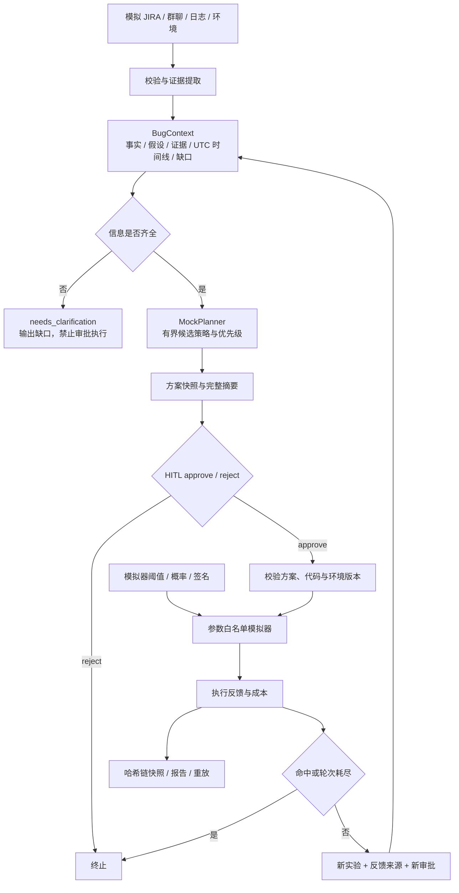
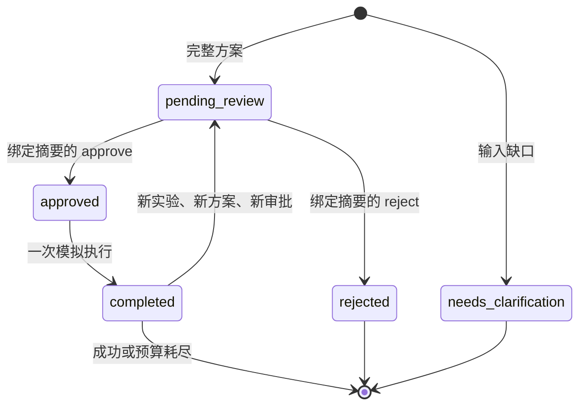

# 架构与数据流

核心是一条受约束的 Agent 循环：整理状态 → 选择实验 → 人工决定 → 执行 → 反馈更新。当前推理模块是确定性 mock，执行模块是概率模拟器。状态流与替换边界是真正可运行的，外部集成留在 MVP 范围之外。

## 数据边界

源数据只有 `id / kind / timestamp / body`；时间戳必须带时区。环境 body 是字符串值 JSON 对象。载入时要求 `synthetic=true`，只读取显式指定的 JSON 文件，每个文件不超过 1MB；不扫描本机文档或企业仓库。

`Evidence` 绑定 `source_id + start + end + quote`，字符位置按 Python 字符串切片定义，不是 UTF-8 字节位置。校验引用、非空区间和逐字匹配。`Fact.provenance` 区分日志 / 执行反馈观察、JIRA / 群聊报告与环境配置。这里的“事实”表示“材料包含此项记录”，不保证材料描述客观真实。群聊中的猜测不会升级成经过日志验证的观察。

`Hypothesis` 必须引用证据，status 保持 `unverified`。匹配模拟签名代表本次实验观察成功，不等于完成根因分析。时间线提供记录顺序，不推断事件间因果关系。冲突环境保留原文证据、明确列出缺口，不让覆盖后的值静默进入执行。

## 策略边界

`Planner.propose(context, history)` 只接收上下文与历次执行反馈；不接收模拟器真值、触发阈值或 benchmark 标签。策略只允许四种整数参数：并发、调度抖动、时钟偏移、缓存年龄。策略必须绑定已有假设及其证据，无法生成 shell、URL、文件写入或外部工具调用。

当前优先级：`证据引用数量 / 每次尝试估算成本 - 0.15 × 此假设此前负反馈轮数`，按分数降序、ID 升序排序。估算成本为 `1 + (concurrency - 1) // 4`。每次命中立即停止，成本为实际执行次数 × 单次成本。负反馈增加相应假设的探索阶梯；其他参数保持基线值。

## 状态转换与人工介入

`iterate` 创建新目录，不修改旧方案。每轮保留上轮策略和反馈，并将反馈加入合成时间线。轮次最多 3；单轮 1..100 次。环境缺口需要修改输入、生成全新实验；本版不提供聊天式追问。人工可以拒绝方案，不能直接修改已经批准的方案。

## 快照格式

每个实验目录最多三个事件：

| 文件 | 事件 | 关键字段 |
|---|---|---|
| `0000.json` | proposal | 原始合成输入、BugContext、候选与选中策略、历史、预算、seed、版本与摘要 |
| `0001.json` | decision | approve / reject、actor、reason、完整 proposal digest |
| `0002.json` | execution | feedback、实际成本、同一 proposal digest |

事件外层包含 schema_version、序号、UTC 写入时间、previous_hash 和 event_hash。哈希采用规范 JSON 的 SHA-256。`.lock` 目录阻止并发写入；先写入并同步临时文件，再通过不覆盖已有文件的硬链接发布。未完成的 `.tmp` 不被当作事件。

方案快照也包含模拟器配置，以支持完整重放。它是执行侧与审计侧可见数据，不会传入 planner。这个分离是函数接口约束，不是操作系统级隔离；代码维护者当然可以读取公开文件。

重放会校验事件顺序、哈希链、审批绑定、原始上下文与策略重新计算结果、代码摘要、Python 精确版本、模拟器摘要，再按 seed 重新执行，核对结果和成本。重新执行会复现业务反馈，写入时间不要求相同。

代码摘要覆盖 `rarebug/*.py` 文件名与内容。重放绑定精确 Python 版本，以避免把跨解释器行为差异当作成功复现。修改代码后应生成新实验；归档快照可以继续 `inspect`，原版本运行环境下才可 `replay`。

## 模块职责

| 模块 | 职责 |
|---|---|
| `models.py` | JSON 契约、规范化摘要、参数范围 |
| `context.py` | 源校验、环境冲突、时间线、引用提取 |
| `planner.py` | Planner 协议、mock 候选、排序与策略绑定校验 |
| `simulator.py` | 有 seed 的概率执行器、匹配签名、尝试次数 |
| `storage.py` | 顺序事件、不覆盖写入、锁与哈希链 |
| `workflow.py` | 跨阶段状态机、审批、执行、迭代、重放 |
| `evaluation.py` | 独立真值读取、对比策略、原始指标与汇总 |
| `report.py` / `cli.py` | 文本展示、命令入口与错误返回码 |
